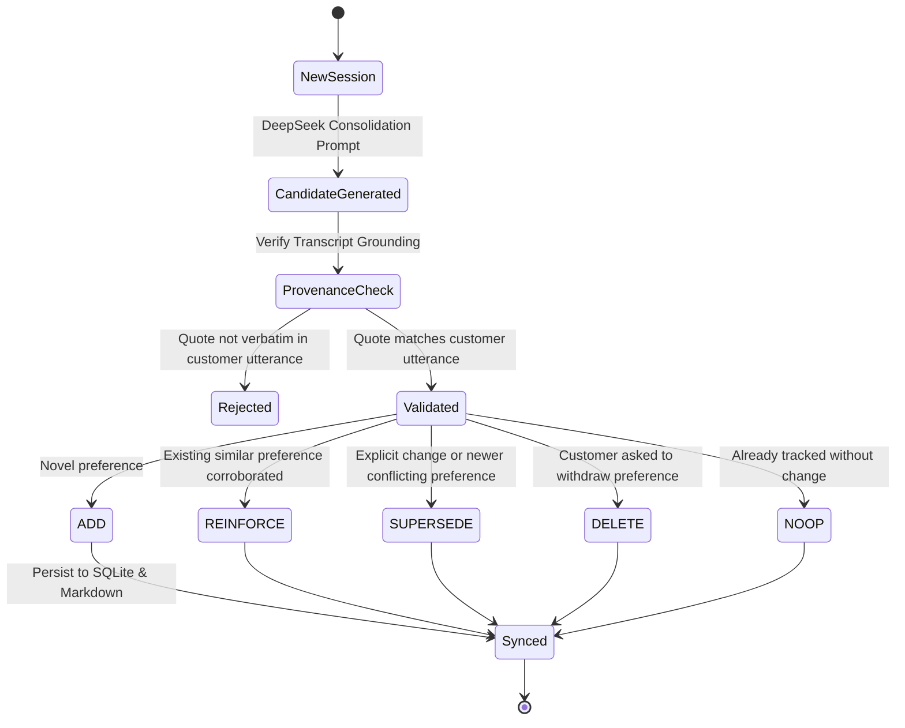

# ASTRA Long-Term Memory Architecture Redesign

## 1. Executive Summary

This document specifies the redesigned long-term memory architecture for **ASTRA** (Autonomous Shopping and Task-Reasoning Agent).

Prior iterations of ASTRA relied on brittle, turn-level regex heuristics (`_check_first_person_ownership`, canonical quote bounds, keyword gates) that repeatedly rejected valid preference proposals extracted by DeepSeek, while procedural learning remained disconnected from vector semantics.

The redesigned architecture establishes two decoupled, complementary memory tiers:
1. **User-Specific Semantic Memory (Personalization)**: Long-term customer profile store combining embedding-based semantic retrieval, category-specific temporal decay, immediate explicit forgetting, and asynchronous end-of-session memory consolidation with strict transcript grounding.
2. **Centralized Procedural Experience Memory (Distillation)**: Shared, privacy-sanitized repository of shopping heuristics and domain rules distilled from completed interactions, retrievable via semantic situation similarity.

Both systems are backed by an ACID-compliant dual-storage engine (SQLite transactional indexing with human-readable Markdown projections) and integrated cleanly into ASTRA's evaluation harnesses and live boundaries without incurring unexpected API calls or breaking legacy benchmarks.

---

## 2. High-Level Architecture

```mermaid
graph TD
    subgraph Customer Interaction
        User[Shopper / Simulated Customer] -->|Dialogue Turns| Agent[ShoppingAgent]
        Agent -->|Search & Verification| Catalog[Product Catalogue / SQLite Index]
        Agent -->|Immediate Forgetting Check| UserStore[UserMemoryStore]
    end

    subgraph Memory Retrieval (Per-Turn)
        UserStore -->|Semantic Vector Search + Time Decay| Agent
        ExpStore[ExperienceStore] -->|Semantic Situation Match + Context Cues| Agent
    end

    subgraph End-of-Session Finalization
        Agent -->|Session Completed / Target Found| Finalize[agent.finalize_session]
        Finalize -->|Consolidation Prompt + Transcript| Consolidator[consolidate_session]
        Consolidator -->|Provenance Verification| UserStore
        Finalize -->|Sanitized Trace + Outcome| Distiller[distill_session_experience]
        Distiller -->|Reinforce or Add Lesson| ExpStore
    end
```

---

## 3. User-Specific Semantic Memory

### 3.1 Vector Embedding Pipeline

Semantic vector retrieval eliminates reliance on verbatim lexical keyword matching between a customer's current query and previously stored preferences (e.g. matching *"workout clothing"* with a stored preference for *"activewear"* or *"workout shirt"*).

- **Embedding Model**: `BAAI/bge-small-en-v1.5` (384 dimensions) via [FastEmbedProvider](file:///Users/yangxu/code/self-improving-agent/src/shopping_agent/embeddings.py).
- **Persistent Embedding Cache**: Embeddings are keyed by `SHA-256(text)` and cached locally on disk (`data/cache/embeddings.db` or dedicated directory) to eliminate redundant model inferences.
- **Deterministic Offline Provider**: [DeterministicEmbeddingProvider](file:///Users/yangxu/code/self-improving-agent/src/shopping_agent/embeddings.py) uses a hash-derived unit vector projection for fast, completely offline, reproducible unit tests without downloading weights.
- **Similarity Metric**: Standard cosine similarity:
  $$\text{Sim}(\mathbf{u}, \mathbf{v}) = \frac{\mathbf{u} \cdot \mathbf{v}}{\|\mathbf{u}\|_2 \|\mathbf{v}\|_2}$$
- **Threshold Calibration**:
  - Baseline unrelated English concepts score $\approx 0.50 - 0.54$.
  - Semantic similarity threshold is calibrated to `min_similarity = 0.58` (cleanly rejecting false cross-category matches such as *"umbrella"* vs *"bags"*, while accepting true paraphrases at $\ge 0.70$).

### 3.2 Temporal Decay & Recency Weighting

Human preferences change at different rates: a customer's shoe or shirt size remains stable for years, while current style inclinations or gift preferences evolve frequently. To prevent stale preferences from dominating newer signals, stored memories apply category-specific exponential half-life decay.

#### Mathematical Formulation
The decay factor $D(t)$ at elapsed time $\Delta t = t_{\text{current}} - t_{\text{record}}$ is defined as:

$$D(\Delta t) = \max\left(M_{\min}, e^{-\lambda \Delta t}\right)$$

where:
- $\lambda = \frac{\ln(2)}{T_{\text{half}}}$ is the category decay rate.
- $T_{\text{half}}$ is the category half-life in days.
- $M_{\min}$ is the floor multiplier (default $0.20$), ensuring old memories remain accessible with lowered weight rather than vanishing completely.

#### Half-Life Configuration
| Memory Category | Configured $T_{\text{half}}$ | Rationale |
| :--- | :--- | :--- |
| `preference` / `dislike` | 14 days | Style, brand, and color preferences evolve rapidly across seasons. |
| `size` / `measurement` | 90 days | Physical sizing and fit requirements change slowly. |
| `purchase` / `allergy` / `fact` | 180 days | Historical purchases and physical constraints are highly durable. |

#### Composite Retrieval Score
When querying memories for a given shopping context:

$$\text{Score}(r, q) = \text{Sim}\left(\mathbf{e}_q, \mathbf{e}_r\right) \times D(\Delta t) \times \text{Confidence}(r)$$

Active memories are ranked by composite score, prioritizing relevant, recent, and highly corroborated facts.

### 3.3 Explicit Forgetting & Instant Withdrawal

Privacy compliance and customer control require immediate, turn-level memory erasure when requested by the customer.

1. **Per-Turn Check**: During `ShoppingAgent.turn()`, prior to executing product searches or policy calls, customer utterances are evaluated against explicit forgetting intents:
   ```regex
   \b(?:forget|remove|withdraw|delete)\s+(?:about\s+me|everything|all|my\s+preference|my\s+size|my\s+dislike|\b[a-z0-9_\- ']+\b)
   ```
2. **Atomic Inactivation**: Stored records matching the requested attribute or scope are updated to `status = 'withdrawn'` immediately in SQLite.
3. **Session Audit**: An event `user_memory_withdrawn` with the withdrawn record IDs is appended to the session trace, preventing the agent from relying on or presenting the forgotten facts in subsequent turns.

---

## 4. End-of-Session Memory Consolidation

Consolidation is completely decoupled from the per-turn shopping loop. DeepSeek handles natural-language conversation without regex gates during the session. When the session finishes, an explicit consolidation prompt processes the complete dialogue history.

### 4.1 Consolidation State Machine



#### Operation Semantics
- **`ADD`**: Creates a new `MemoryRecord` with a generated UUID (`um-<hex>`), initial status `active`, timestamps, and computed vector embedding.
- **`REINFORCE`**: Corroborates an existing active memory (`target_id`), updating `last_confirmed_at = now()`.
- **`SUPERSEDE`**: Replaces an existing active memory (`target_id`). The old record is set to `status = 'superseded'` and `superseded_by_id = new_id`. The new record references `supersedes_id = target_id`.
- **`DELETE`**: Withdraws a record explicitly, setting `status = 'withdrawn'`.
- **`NOOP`**: Explicitly leaves existing state untouched when no durable changes occurred.

### 4.2 Provenance & Anti-Hallucination Gate

To prevent LLM hallucination from corrupting long-term memory profiles, proposed consolidation operations must pass a strict provenance check:
- Every proposed operation's `quote` must exist as a verbatim substring within the authenticated customer utterances of the current session.
- Quoted speech from the assistant, catalogue cards, or ungrounded facts are rejected with reason `quote_not_grounded_in_session_transcript`.

---

## 5. Centralized Procedural Experience Distillation

Whereas user memory tracks *who the customer is*, procedural experience tracks *how ASTRA should act*.

### 5.1 Privacy-Preserving Sanitization

Session traces contain customer specifics, session IDs, and catalog references that must never leak into shared procedural lessons. The distillation pipeline applies strict sanitization:
1. Strips customer identifiers (`user_id`, session UUIDs, timestamps).
2. Redacts specific product titles, ASINs, and direct entity references.
3. Generalizes dollar amounts into relative thresholds (e.g., *"$45"* $\to$ *"budget constraints"* or relative bounds).
4. Normalizes dialogue turns into abstract behavioral sequences: situation $\to$ action taken $\to$ observed outcome $\to$ recommended directive.

### 5.2 Lesson Lifecycle & Semantic Retrieval

- **Lesson Schema**: Enriched with `situation`, `strategy`, `rationale`, `confidence`, `usage_count`, `success_count`, `failure_count`, and vector `embedding`.
- **Semantic Retrieval (`retrieve_semantic`)**:
  When ASTRA receives a customer request, the current situation query is embedded and compared against active procedural lessons. When `context_cues` are provided (e.g. `is_initial: True`), trigger conditions are verified to prevent initial-turn guidance from firing on follow-up turns.
- **Reinforcement (`reinforce_or_add_lesson`)**:
  When a candidate lesson is generated from a completed session:
  - If cosine similarity to an existing active lesson $\ge 0.82$ with matching action signature, the existing lesson is reinforced (`usage_count += 1`, `success_count += 1`, `confidence = min(0.99, conf + 0.05)`).
  - Novel lessons are registered as candidates and confirmed according to review policies.

---

## 6. Dual-Storage Engine: SQLite + Markdown

To satisfy both high-performance vector/ACID transactional requirements and human inspectability, ASTRA employs a dual-storage engine:

```
data/user-memory/<user_id>/
├── profile.db        # SQLite: ACID transactions, embeddings, audit history
└── profile.md        # Atomically synced readable Markdown projection
```

### 6.1 Transactional SQLite (`profile.db`)
- Houses `records` (with vector embeddings stored as serialized float arrays in `embedding_json`) and `meta` (schema revision, user ID, `last_consolidated_session_id`).
- Supports process-level and thread-level re-entrant locking (`threading.RLock`) to guarantee isolation across concurrent turns and subagents.

### 6.2 Human-Readable Markdown Projection (`profile.md`)
- Synced atomically after every consolidation transaction.
- Lossless round-trip capability: legacy test suites and human operators can inspect or edit `profile.md`. If SQLite is empty, `_sync_legacy_markdown` populates the database automatically.
- Nullable schema fields (`updated_at`, `last_confirmed_at`) prevent integrity crashes on legacy markdown fixtures.

---

## 7. Target-Item Evaluation Mode

In longitudinal benchmark evaluations (`evaluation_mode = "target_item"`):
1. **Immediate Termination**: When ASTRA recommends the predetermined target item at rank $\le k$, dialogue execution immediately halts with `termination = "target_found"`. No further shopper follow-ups or provider network calls are made.
2. **Explicit Finalization Seam**: Dialogue runners support an opt-in hook (`agent.auto_finalize = True` or explicit `agent.finalize_session()`). Existing benchmark suites run without automatic post-session LLM calls, protecting established token and dollar cost budgets.

---

## 8. Memory CLI Inspection Tool

A unified inspection CLI is available for developers and operators:

```bash
# Inspect customer memory profile
python3 -m shopping_agent.inspect_memory --user alice

# Inspect centralized procedural lessons
python3 -m shopping_agent.inspect_memory --experience
```

Output is returned as clean, formatted JSON summarizing revision history, active records, decay weights, and procedural distillation statistics.
