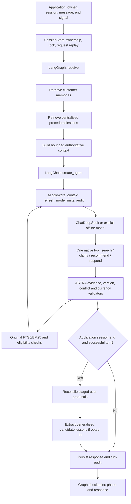

# Experimental LangChain / LangGraph architecture

This is an alternative implementation, not the primary ASTRA memory redesign. Baseline:
`6e7b42cb77b6389c9b154e5b967ee699385a7572` (merged PR #28). Branch:
`experiment/langchain-refactor`. Isolated worktree: `/Users/yangxu/code/astra-langchain-refactor`.
The original worktree and Antigravity's `feat/long-term-memory-redesign` changes are not inputs
to this implementation. No baseline application, retrieval, evaluator or ground-truth file
is modified. Optional dependency configuration and documentation are the only shared edits.

## Run the alternative

Python 3.11+ is declared by ASTRA; this experiment was exercised with Python 3.14 on macOS
arm64. The framework extra is optional; the ordinary installation remains independent.

```sh
python3 -m venv .venv
.venv/bin/python -m pip install -r requirements-langchain-lock.txt
.venv/bin/python -m pip install --no-deps -e '.[langchain]'
.venv/bin/python -m astra_langchain --root data/langchain-experiment/my-demo --end-session
```

The default command uses an explicitly labelled offline model and a tiny synthetic catalogue.
It never reads credentials or contacts a provider, and is not a live fallback. Use a fresh
root; creation refuses to overwrite an existing experiment. Output includes the session ID.
For offline continuation, pass the same root, `--session <ID>`, and `--message '...'`.
Memory permissions and mode must match the manifest. An ended session cannot be reopened.

`--user-memory` opts into scoped profile reads and session-end writes. `--learn` opts into
candidate-only procedural extraction from learning observations; never use it on held-out
visits. `--end-session` is an application signal, not something the LLM can set. For a real
model, memory store and catalogue, use the Python adapter:

```python
from astra_langchain.workflow import LangChainShoppingAgent

agent = LangChainShoppingAgent(
    session_store, lexical_search, model,
    user_memory=isolated_user_memory,    # None means OFF: no reads or writes
    experience=isolated_experience,     # active snapshot or local store
    checkpointer=sqlite_checkpointer,   # optional diagnostic snapshots
)
response = agent.turn(user_id, session_id, message, request_id=request_id)
# Pass end_session=True on the last message to consolidate proposed memory.
```

Live CLI support is present but **no paid execution is authorized by this experiment**.
After separate approval, `--live` also requires `--index`, `--env-file`, and `--budget-usd`.
It uses the fixed original DeepSeek endpoint, configured `deepseek-flash`, three model calls,
two searches, 2,000 output tokens, a 25-second timeout, disabled thinking and zero SDK retries.
`--prior-usd` carries reviewed previous expenditure into the unchanged shared budget helper.
An existing paid journal blocks another CLI launch: review prior accounting, preserve the
old output, and select a fresh root. Do not use a new root to bypass unresolved reservations.
This conservative CLI does not yet provide interactive paid session continuation; the Python
adapter can reuse one explicitly budgeted model across turns.

## Architecture and authority



The actual graph, including its conditional edges, is inspectable with
`agent.graph.get_graph().draw_mermaid()`. The inner agent uses current
`langchain.agents.create_agent`; no deprecated agent constructor is used.

| Original component | Experimental mapping | What stays authoritative |
| --- | --- | --- |
| `ShoppingAgent.turn` loop | `workflow.py` + `create_agent` + `AstraMiddleware` | Session ownership, versioned state, bounded execution |
| `DecisionPolicy.complete` / urllib transport | `BudgetedDeepSeek`, LangChain chat-model interface | Fixed provider configuration and unchanged cost ledger |
| Structured JSON action | Four native tools with action-specific closed Pydantic schemas | Existing `Decision`, quoted `apply_updates`, hard constraints |
| Context construction | Original bounded legacy builder, adapted in middleware | Current facts, feedback and model-visible candidate receipt |
| Search | `search_products` → original `LexicalSearch` | Frozen index, BM25 ranking, filters, unknown-field rejection |
| Recommendation | `recommend_products` → original `verified_products` | Current state/catalogue, receipt-visible IDs, eligibility recheck |
| Clarification / response | Explicit audited tools | Asked/disclosed ledger and redundant-question guard |
| User profile | Graph retrieval and session-end reconciliation | Original Markdown profile, owner lock, evidence/revision checks |
| Procedural memory | Cue retrieval + session-end template extraction | Original SQLite/snapshots, candidate review lifecycle |
| Session history | Original JSONL events and rebuildable snapshot | Request replay and interrupted-turn refusal |
| Graph persistence | Optional SQLite checkpoints | Diagnostic workflow state only; not semantic memory or authorization |
| Evaluation | Existing `DialogueRunner`, `TargetRule`, `target_score` | Independent truth, scoring, catalogue oracle, unmodified datasets |

The four native tools preserve explicit action names and evidence-bearing updates. Memory
retrieval is enforced by graph nodes rather than exposed as optional model tools: OFF cannot
be bypassed by a model call. A separate product-details tool is unnecessary for this slice,
because the bounded candidate projection already carries the facts used by the original gate.
Adding a tool requires a schema, deterministic executor, middleware allowlist entry, and tests;
a decorator alone does not provide ASTRA's trust boundary.

## Deliberate differences and limitations

- Native tool calls replace JSON-mode responses. Bare text, malformed tool-call envelopes and
  parallel calls fail closed. Schema/guard rejection can be repaired within the three-call
  budget. Terminal actions end without a gratuitous final model call. This is a behavior
  change, not evidence that a live model will make the same decisions.
- The experiment uses the supported **legacy structured state/context** as the comparison
  contract. Normal ASTRA UI uses compact v7. Compact field aliases, narrow redundant compact
  retraction repair and alternative card projection profiles are not ported. Legacy prompts
  retain their behavioral rules, but replace the JSON transport instruction and omit the
  redundant JSON schema/example because native tools carry their own schemas.
- Each model invocation sees a bounded projection from authoritative ASTRA events; it does
  not accumulate a second unbounded tool conversation. Search tool messages give a receipt
  and counts; the next projected context contains eligible cards. This trades conventional
  full native tool history for ASTRA's established candidate visibility boundary.
- ToolNode dispatches even one tool on a worker thread. Read-only SQLite search connections
  are reopened per execution. No global SQLite thread-safety setting is weakened. The adapter
  is synchronous; application instances and shared writable experience stores are not promised
  to support concurrent turns.
- User memory is selected once at turn entry. Proposals are evidence-checked and staged in
  owned session events, then reconciled at explicit session end. Ordinary baseline ASTRA
  persists accepted proposals during a turn. Until consolidation, staged facts are not durable
  cross-session recall and do not get persistent IDs for further model corrections. A conflict
  at consolidation is logged and stops that batch sequence; it is not silently rebased. A
  session can close with rejected memories, which remain auditable for explicit review.
- Only the baseline lexical/scope retrieval is reused. There is **no embedding implementation
  in this baseline**. Antigravity's uncommitted embedding/reconciliation modules are not copied.
  An embedding-backed store can later implement the same `context`/`apply` interface, with
  provenance and ownership tests. Checkpoint storage does not supply semantic retrieval.
- Procedural extraction uses existing predefined templates and aggregate search counts. No
  identities, utterances, product IDs or evaluator feedback enter centralized candidates.
  Existing candidates/reviewed lessons are never overwritten and no lesson is activated.
- Checkpoints record phase/response and permit local inspection after restart. Completed
  request IDs replay from ASTRA JSONL without another model call. Interrupted operations do
  **not** auto-resume: event/profile/checkpoint writes are not one transaction, and remote
  billing is not exactly-once. An interrupted request requires inspection and a new ID.
- No remote tracing is enabled: workflow execution uses `tracing_context(enabled=False)`.
  LangSmith remains a transitive framework package, not a required account or service.
  As with baseline ASTRA, local logs contain customer content and require appropriate access.

## Provider compatibility evidence

The local configuration was inspected without printing credentials: `DEEPSEEK_MODEL` is
`deepseek-flash`; baseline transport targets `https://api.deepseek.com/chat/completions`.
The adapter preserves both. Mock HTTP tests verify the serialized model, endpoint, tool
schemas (excluding injected runtime), thinking mode, output cap, usage settlement and no
retry after HTTP failure. Missing usage retains reservations and blocks further requests.
Request payload reservations include native tool schemas. No prices or scoring are changed.

This is documentation + local serialization compatibility, **not a live API smoke result**.
Before any paid comparison, reverify rates, approved budget, provider behavior and equivalent
model/context settings. Native tools necessarily alter prompt/transport, so report that
confound separately from orchestration latency and memory outcomes.

Official APIs consulted on 2 November 2026:
[create_agent](https://docs.langchain.com/oss/python/langchain/agents),
[middleware](https://docs.langchain.com/oss/python/langchain/middleware/custom),
[checkpoints](https://docs.langchain.com/oss/python/langgraph/persistence),
[ChatDeepSeek](https://docs.langchain.com/oss/python/integrations/chat/deepseek), and
[DeepSeek tool calls](https://api-docs.deepseek.com/guides/tool_calls/).
DeepSeek's current tool-call example explicitly uses `deepseek-flash`; the LangChain
integration overview still discusses older model names, so the adapter's wire tests are
necessary rather than assuming the overview guarantees this configuration.

## Validation and comparison

```sh
.venv/bin/python -m unittest discover -s tests -p 'test_langchain*.py' -v
# Full baseline tests also require requirements-ui-lock.txt; some asset tests may skip.
.venv/bin/python -m unittest discover -s tests -q
.venv/bin/python -m experiments.langchain.compare --output data/langchain-experiment/new-comparison.json
```

Framework tests block socket connections, except provider tests which exclusively use
`httpx.MockTransport` with a fake key. Tests cover basic search/recommendation, clarification,
state invalidation, conditional preferences, currency/conflict guards, budgets/deduplication,
OFF/ON and owner isolation, cross-session recall/correction, end consolidation, procedural
retrieval/candidate-only learning, request replay, SQLite checkpoints, safe errors, native
schema repairs and unchanged target-item evaluation. The optional tests skip when the extra
is not installed. Baseline test files are unchanged.

The offline comparison runner reports behavioral parity, model/search counts, construction
and turn timings, and serialized request-size proxies. These measurements do not establish
recommendation quality or live token costs.

Measured results and the adoption recommendation are in the
[comparison report](reviews/langchain-comparison.md).
