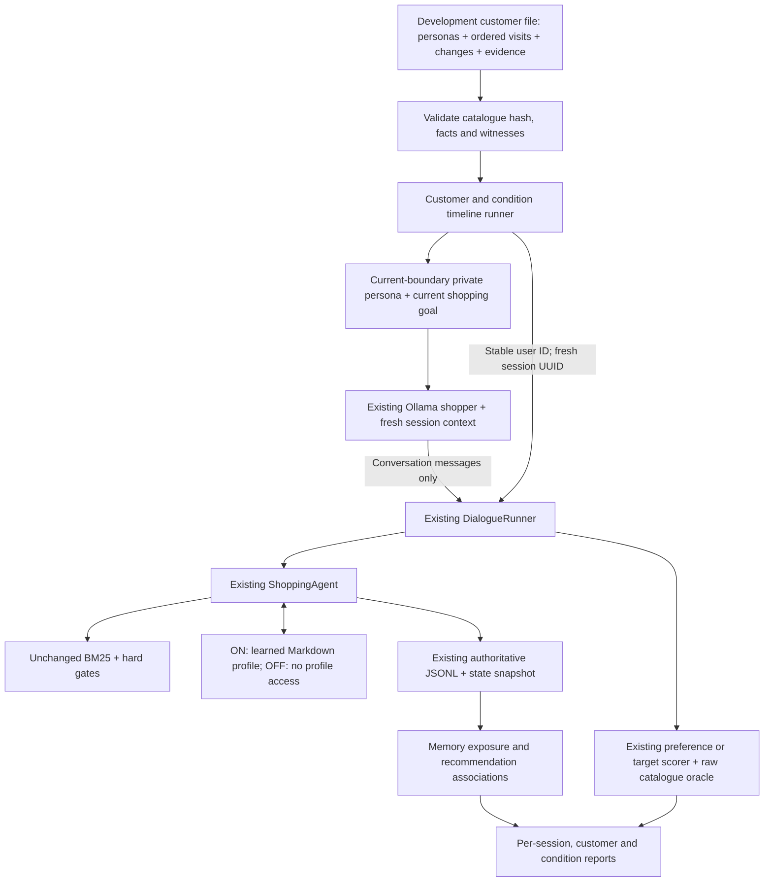

# Stage 2: returning-customer development evaluation

This is a thin orchestration layer above the existing session evaluator. It compares the
complete Stage 1 user-memory feature OFF/ON. Procedural experience is OFF in both arms.
No external learner, held-out customer benchmark or live effectiveness result is implemented.

## Data flow



The evaluator never initializes `Profile` from `Frozen`. Only ordinary application decisions
with current-user quoted evidence can write user memory. Shopper context contains no future
visits, future change objects, target IDs, witness evidence or condition labels.

## Dataset schema and examples

`experiments/longitudinal/customers.dev.json` has three invented development customers and
four visits each. It is manually directed, not an automatically expanded benchmark.

| Record | Main fields |
| --- | --- |
| Dataset | `schema_version`, `dataset_id`, development split, catalogue hash, provenance |
| Customer | stable `user_id`, personality, background, interests, scoped preferences/dislikes |
| Change | `before_sequence`, updated preference keys, removals, optional new background |
| Visit | unique `task_id`, sequence, goal/category, self/gift, mode, opening, disclosure plan |
| Visit requirements | hard/soft facts and relevant current persistent keys |
| Private evidence | witness ID, acceptable count, matching-ID hashes, source field paths |

The task ID is a frozen session blueprint, not a reused ASTRA session UUID. Runtime records
contain both IDs. Sequences must be contiguous; customer/task IDs are safe and unique.
`Customer.state_at(n)` applies only changes effective by n. `compile_visit()` gives the shopper
the current background/preferences and the current goal, not the complete timeline.

| Customer | Visits |
| --- | --- |
| `dev-traveler` | Yellow folding umbrella; Yellow stick umbrella recall; travel wallet; Blue umbrella gift |
| `dev-fashion` | Silver bangle; Silver necklace recall; Gold bangle gift; change own jewelry preference to Gold |
| `dev-changing-needs` | Leather wallet; second wallet recall; change to Nylon; unrelated pendant gift |

No lightweight, waterproof or other undocumented product property is scored. Category matching
uses the existing token ontology, not exact leaf membership. All witnesses satisfy hard and
soft facts using explicit raw fields. Missing facts do not establish compatibility. Exact
targets can be ambiguous; their complete-profile compatible counts remain explicit. The
wallet correction target, for example, has two compatible products in this catalogue.
Repurchases can share a witness; these are reviewed development fixtures, not a diversity claim.

`validate_dataset()` checks literal fact/disclosure agreement (including numeric operators),
opening disclosures, source usability, witnesses and saved evidence hashes. It reuses the
existing disclosure checker and raw-catalogue oracle. These are bounded contracts, not full
semantic verification of persona realism; manual dataset review remains necessary.

## Execution and isolation

`run_longitudinal()` loops customer → condition → ordered visit. The first customer runs
OFF then ON; the next runs ON then OFF. This rotates whole timelines, never shuffles visits.
Every visit calls existing `DialogueRunner.run()` with the same customer user ID and a new
session. Default single-session callers keep their original per-scenario identities.

Each condition has its own `astra/<condition>/sessions/` and optional `user-memory/` root.
OFF never constructs or opens a user-memory store. ON begins empty in a new run and accumulates
naturally. Customers are separated by session ownership and hashed profile paths. There is no
profile copy between arms. Both agents receive `experience=None`. The normal shopping agent,
catalogue, retrieval, session storage and procedural store implementations are unchanged.

Each visit has a turn limit and DeepSeek-call cap, plus a shared global run cap. The inherited
conservative turn reservation remains: three available calls may be required to start a turn.
Target tasks stop on the first actual presented target hit at primary K, not an internal
retrieval hit. Preference tasks retain their existing stopping rules. Invalid prior sessions
block later visits in that customer/condition, because their memory history is incomplete;
other arms can continue unless the global budget stops the run. Blocked/unstarted visits and
incomplete pairs stay explicit. Runs cannot overwrite/resume existing output directories.

## Scores and diagnostics

Primary metrics stay separated by evaluation mode:

- Target tasks: existing Hit@K and first-qualifying-list reciprocal rank, success-only MTTC,
  failure penalty `turn_budget+1`, cumulative success by turn.
- Preference tasks: existing suitability success and first-list nDCG. No invented exact-target
  MRR is assigned. First success and efficiency are derived from the existing scored turn.
- Search/clarification counts to first success use only that prefix; total resources include
  the complete session. Secondary suitability for target tasks is censored by target stopping.
- Reports show all-started success rates and valid-only rates. Invalid started tasks remain
  visible; unstarted tasks are not silently called successes or evaluated failures.
- Disclosed-requirement compliance uses existing per-recommendation state snapshots and the
  independent raw oracle. This remains distinct from hidden-profile suitability.

There is no arbitrary weighted score. Reports aggregate per customer/condition and by mode,
plus resources, terminations, planned/unstarted tasks and complete/incomplete pairs.

Memory diagnostics inspect authoritative event payloads:

- retrieved/injected IDs, accepted/rejected update batches;
- relevant recommendation matches, and outdated/irrelevant/recipient-inapplicable exposure;
- `potential_incorrect_reuse`: a shown product matches an exposed old/inapplicable value and
  fails the current private field requirement.

These are associations, not causal attribution. An old memory may need to be visible for a
correction, and a private change may not yet have been disclosed. Neither exposure nor private
mismatch alone is a violation of a disclosed user requirement. Unmapped attributes/scopes are
unassessed. ON also changes the Stage 1 instructions/schema; differences with an initially empty
profile are not evidence of recalled-memory benefit. Later dialogue histories can diverge.

DeepSeek and Ollama reported usage is retained. Missing usage is not zero cost. Inherited
shopper failures can omit failed transport attempts/tokens because the existing adapter does
not return statistics on exceptions; affected sessions are explicitly flagged. Price estimates
require supplied rates and are not billing records. No complete failed-call accounting claim
is made in this stage.

## Commands and artifacts

Free validation/plan only; this does not load a key, construct a model client, write outputs
or create profiles:

```bash
.venv/bin/python -m astra_eval longitudinal \
  --customers experiments/longitudinal/customers.dev.json \
  --output data/eval/longitudinal/dev-review \
  --limit-customers 1 --headline-k 5 --max-model-calls 144
```

One complete customer plans eight sessions (four visits in two arms), at most 144 DeepSeek
calls with default caps. All three plan 24 sessions / 432 calls. These are upper bounds, not
usage measurements. Actual live execution would require `--live`, an explicit budget and
separate user approval; no live DeepSeek or Ollama experiment was run for Stage 2.

After an approved run, the existing report command dispatches to the longitudinal report:
`.venv/bin/python -m astra_eval report <run-directory>`. Session transcripts are directly
inspectable under the paths below; the legacy `show` command retains its single-session layout.

Fully mocked reproduction (synthetic catalogue, no key/network/model server):

```bash
.venv/bin/python -m unittest discover -s tests -p 'test_longitudinal*.py' -v
.venv/bin/python -m unittest discover -s tests -p test_customers.py -v
```

The tests exercise real ASTRA sessions, BM25, scoring and Markdown updates with test-only
policies and scripted/mocked-HTTP shoppers. They are functional evidence, not measured gains.

```text
<run>/
  customers.frozen.json               # exact input bytes; private to evaluator
  run.json                            # input/truth/index hashes, code, settings, ordering
  summary.json                        # started/planned, actual calls, blocked/stop reasons
  results.jsonl
  report.json / report.md
  astra/<condition>/sessions/<UUID>/events.jsonl + state.json
  astra/user_memory_on/user-memory/<hashed-user>/profile.md
  sessions/<condition>/<user>/<task>/transcript.jsonl + trace.json + result.json
```

Each result identifies customer/user, sequence/task, runtime session UUID, condition, mode and
termination. Input bytes, compiled scoring truth, catalogue/index, requested model/settings,
prompt versions, budgets and ordering are recorded. Actual agent model metadata remains in
events. Seeds and frozen inputs do not freeze LLM outputs; mutable model aliases/weights and
platform differences can still change behaviour. Existing benchmarks/results are untouched.

## Code to study

1. `customers.py`: `Customer.state_at()`, `compile_visit()`, `validate_dataset()`.
2. `longitudinal.py`: `LongitudinalConfig`, `plan_longitudinal()`, `run_longitudinal()`.
3. `dialogue.py`: optional stable owner/current-shopper-context inputs; existing loop unchanged.
4. `memory.py`: current-only private context appended only for longitudinal shoppers.
5. `longitudinal_report.py`: `memory_audit()`, `summarize()`, `write_longitudinal_report()`.
6. Existing `target_scoring.py`, `scoring.py`, `disclosed_compliance.py`, `oracle.py`.

Stop after Stage 2 for customer-data and implementation review. A four-arm procedural-memory
comparison, external LLM learner and held-out customer set are not implemented here.
