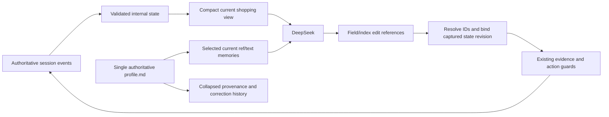

# Compact shopping state and readable user profiles

The API never received the complete event history or every stored provenance field. This
change further separates shopping information from execution/audit metadata. It changes
representations, not catalogue matching, memory relevance selection, or learning rules.

## One authority, different views



Internal requirement IDs, state revisions, source quotes and correction history remain in
canonical events. They are not repeated inside the compact API state. `events.jsonl` remains
authoritative; a compact `state.json` is a rebuildable current-view cache, not another history.

## Compact session state

```json
{
  "hard": {
    "category": [{"contains": "boots"}],
    "price": [{"gte": 40}, {"lt": 80}],
    "color": [{"not_contains": "black"}]
  },
  "preferences": {
    "material": [{"eq": "leather"}]
  },
  "clarifications": {
    "price": {"status": "answered", "asked": true},
    "color": {"status": "needs_followup"}
  }
}
```

Lists preserve multiple simultaneous conditions. Exact operators, alternatives, exclusions
and hard/soft meaning are retained. Excluding black does not answer which color is preferred.
Currency/width values appear in clarifications when not represented by a normal requirement.
Conflicts appear only when present. No redundant `intent=buying` field is added.

Edits still use existing ADD/REPLACE/RETRACT/NEW_GOAL evidence contracts, but compact targets
are current paths such as `hard.price.1`. Python resolves these to internal IDs and supplies
the revision captured before the model request. The compact model contract does not contain
`based_on_state_version`. Invalid references fail closed. Search receipts keep state/catalogue
versions internally; actual product/search IDs and authoritative product facts remain visible.
Removing soft-match ID annotations does not change BM25 or the hard filter.

Schema-2 compact `state.json` wraps this state with user/session ownership, last-event position
and `_audit` containing revision/goal counters. Full canonical state is reconstructed from
events. Legacy schema-1 snapshot generation remains available for existing evaluation paths.

## Readable user profiles

New writes use Markdown prose for active entries, for example:

```markdown
# ASTRA user memory

User: alice

## Preferences
- Usually prefers color: Blue (for bags).
```

Facts, Dislikes and Purchases have equivalent sections. Inferences are explicitly labelled.
A collapsed **Audit metadata (managed by ASTRA)** section contains compact JSON with full
provenance, revision, superseded/retracted records and approval/evidence distinctions. It is
part of the same atomic file, not a companion database. The metadata is authoritative and
the visible text is deterministically derived; inconsistent manual edits fail validation.
Markup is escaped, and current-value prose does not reproduce superseded correction wording.

Historical bullet profiles remain readable without an automatic rewrite. A later accepted
update writes the new format while retaining history. Existing evidence, ownership, revision,
purchase confirmation, concurrency and atomic-write checks are unchanged. Readability does
not imply fewer disk bytes: the one-record fixture grows from 533 to 647 characters because
the audit record is preserved and a prose presentation is added.

The compact API receives only selected current entries:

```json
{
  "records": [
    {"ref": "memory.0", "text": "Usually prefers color: Blue (for bags)."}
  ]
}
```

Memory updates remain structured, evidence-backed proposals. `memory.0` is resolved to a real
current record ID, never a user-selected path or arbitrary old memory. Actual canonical
injection data remains in model-request audit metadata, outside `messages` sent to DeepSeek.

## Compatibility and scope

`memory_format=legacy` preserves existing policy/state projection and schemas; `compact`
selects prompt `shopping-baseline-v7-compact-memory`. Library/evaluation defaults remain
legacy so old experiment conditions are not silently changed. Application composition and
explicit experiment selection are separate checkpoints of this change.

No old log, frozen benchmark, dataset, procedural lesson or existing profile is bulk-migrated.
There is no embedding index, semantic-retrieval experiment, LLM summarizer or new learning
mechanism here. Existing user-memory scope matching remains unchanged.

## Offline size checks

Two synthetic cases, same content and no products/dialogue, compared actual serialized
message contents. The user-memory fixture uses the real six-field legacy projection, not
the exhaustive stored record. These are character counts, not DeepSeek token measurements:

| Fixture/component | Legacy characters | Compact characters |
| --- | ---: | ---: |
| Empty whole prompt | 7,910 | 6,625 |
| Range/preferences + one memory, whole prompt | 11,204 | 9,405 |
| That fixture's state | 650 | 246 |
| That fixture's user-memory block | 165 | 81 |

The measured whole-prompt reductions are about 16% in these two cases. Live recommendation
quality, billed-token savings and cost effects remain unverified. Larger product/history
payloads can change the proportion. Product candidate count/order and retrieval are unchanged.
