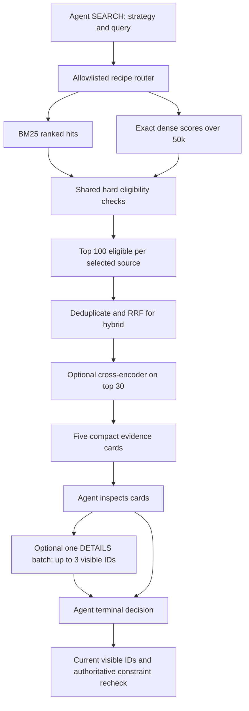

# Multi-stage retrieval proposal — not implemented

31 October 2026. Audited runtime source at `a3460b5`, now merged through `a29e559`.
This is a design/experiment checkpoint. No application behavior, retrieval, contracts,
dependencies, sessions, evaluation infrastructure or AGENTS.md were changed. No models were
downloaded and no new provider requests were made. `technical_researcher` investigated local
models/corpus/hardware; `architecture_reviewer` independently traced compatibility and ran
a temporary schema-evolution probe. Their findings are consolidated below.

## Recommendation

Keep the original weighted FTS5/BM25 path as a frozen baseline. Experiment with BGE-small
exact dense retrieval and BM25+dense reciprocal rank fusion (RRF), then test an optional
small cross-encoder only if it helps. Separate local candidate-pool size from the number of
cards sent to the LLM. Start at 100 eligible candidates per source, at most 200 after union,
optional reranking of 30, and **five final source-backed cards**. These sizes are proposed
settings to test, not measured optima.

Use deterministic extractive cards rather than an LLM summarizer. A single optional batched
DETAILS action may expand evidence for up to three already visible, eligible products.
Keep strategy choice with the shopping policy through an allowlisted Search.strategy;
Python owns construction, fusion, gating, evidence, limits and final verification.

This implements no long-term/user/experience memory. Existing scoped context injection
remains the future experience-learning seam; lessons could guide strategy/query/detail
selection later without owning product truth or execution.

## Current payload and latency audit

Nine local live-session log files were inspected without opening original SessionStores;
four contain actual model calls. The fixed audit snapshot contains **26 model requests,
16 executed searches**, 164,441 API-reported input tokens and 3,259 output tokens.

| Boundary | Observed candidate counts |
| --- | --- |
| 16 search results | 13 return 10 products; one returns 1; two return 0 |
| 26 decision contexts | 18 contain 10 current candidates; two contain 1; six contain none |
| Prior recommendation history | 14 decision contexts contain prior product cards |

SEARCH defaults to 10 and permits 1–20; RECOMMEND permits 1–5. A valid previous search can
also appear at the start of a later user turn, so a result may be sent more than once.
See [contracts.py:115](../../src/shopping_agent/contracts.py#L115),
[context.py:157](../../src/shopping_agent/context.py#L157) and
[agent.py:80](../../src/shopping_agent/agent.py#L80).

Those searches returned 131 candidate instances in total, while decision contexts transmitted
182 current and 80 historical product instances. These are instances, not unique products.
Serialized on their own, the 13 ten-card search arrays have a median of 3,581 tokens in the
old representation and 1,508 under v3 projection. The per-call table below measures their
actual enclosing prompt positions and weights repeated transmissions, so its median differs
slightly. Neither count is the total billed input for a decision call.

The product-token measurement isolates serialized candidate arrays and historical product
arrays inside the saved user-context string, assigning tokenizer tokens by their first
character offset. It excludes system/schema/state/search headers, and counts repeated
transmissions again. The same published V4 tokenizer and temporary audit-only tokenizer
installation from the [compaction audit](context-and-storage-compaction.md) were reused.

| Product payload | Actual saved v2 | Offline projected v3 |
| --- | ---: | ---: |
| Ten-current-card contexts: median tokens | 3,582 | 1,511 |
| Ten-current-card contexts: range | 3,087–4,051 | 1,063–1,741 |
| History-product contexts: median tokens | 1,811 | 766 |
| Current candidate-array tokens across all 26 calls | 66,143 | 26,698 |
| Historical product-array tokens across all 26 calls | 28,250 | 11,229 |

Actual arrays with no products contribute their trivial serialization overhead where present.
The current/historical product arrays together account for about **57.4%** of actual API input
in this small, nonrepresentative sample. Whole message-content tokens are 163,739 in the
saved requests versus 87,798 under the offline v3 reconstruction; this is not a new live run.
The difference from API input is 27 tokens per call, whose server internals are unobserved.

**Serving-version prerequisite:** every saved request's metadata and body still identify
`shopping-baseline-v2`, including the latest at 04:19:42 UTC. The v3 context/storage commits
were created at 04:01:35/04:13:59 UTC. Thus no saved live v3 call was available to measure.
The serving process's working directory matches this repository; a cached process is a
plausible cause, but its loaded code was not independently inspected. Restart/verify the
serving build and record a v3 prompt before a future live comparison. Do not attribute old
versus v3 savings to a new retriever or assume the checked-out source is what served a call.

For latency, the 16 exact historical query/state pairs were independently recomputed against
the read-only real index: every count and ordered candidate ID list matched. One warm-up
plus five timed searches per case, with case order shuffled using seed 42, produced 80 warm
measurements: **p50 38.9 ms, nearest-rank p95 366.2 ms, maximum 491.4 ms**. Broad OR queries
scanning roughly 34k matches had case medians around 339–366 ms; a 72-match query was below
1 ms. This measures the existing tool, including SQL, record parsing and hard gating; it
excludes model load/encoding, DeepSeek, rendering and cold-cache work. Background load was
not controlled. These observations are not a representative benchmark or dense latency result.

The current [ranked scan](../../src/shopping_agent/retrieval.py#L326) assesses **all lexical
matches before the visible limit**. A five-card limit alone does not reduce that scan cost.
The [v3 projection](../../src/shopping_agent/context.py#L76) already removes presentation
fields, preserves all visible IDs/order and strips duplicated title/category prefixes.

## Corpus, hardware and local models

The catalogue remains 50,000 parent products, hash
`da979b05a68af864cb0dcf9ee6a81c010c7e66a57978ad286c7a2e005fc69a67`.
49,990 contain Clothing, Shoes & Jewelry; this is primarily a fashion/accessories corpus.
Overlapping categories include Women 29,435, Men 12,420, Shoes 11,810 and Jewelry 5,127.
The JSONL is 60.5 MB and existing SQLite index 172.8 MB, using decimal units.

Recognized non-null structured facts cover department 87.2%, price 20.8%, brand 5.6%, color
4.9%, material 4.3% and size 1.9%. Description is empty for 47.8%. Source text may mention
an attribute absent from the trusted fact projection: similarity or a snippet cannot silently
upgrade it into a verified hard fact. All methods retain the same unknown handling and
parent-versus-variant/availability limitations. Existing searchable text has median 97 and
p95 381 regex words, not model tokens; real tokenizers must measure truncation rates.

Local inspection found an Apple M5 Pro, 15 CPU cores, 16 GPU cores, 24 GB unified memory,
macOS 26.5.2 and project Python 3.14.3. No inference/MPS test was run. Do the authorized local
experiment in a separate pinned environment, leaving the live environment intact.

| Candidate | Dimensions / input limit | One weight artifact, approximately | License / purpose |
| --- | --- | --- | --- |
| [BAAI/bge-small-en-v1.5](https://huggingface.co/BAAI/bge-small-en-v1.5) | 384 / 512 tokens | 133 MB; 33.4M parameters | MIT; first dense candidate |
| [intfloat/e5-small-v2](https://huggingface.co/intfloat/e5-small-v2) | 384 / 512 tokens | 133 MB; 33.4M parameters | MIT; alternative encoder if BGE needs a challenger |
| [cross-encoder/ms-marco-MiniLM-L6-v2](https://huggingface.co/cross-encoder/ms-marco-MiniLM-L6-v2) | Scalar score / 512 combined query+document tokens | 90.9 MB; 22.7M parameters | Apache-2.0; optional top-30 reranker |

Weight-file sizes exclude tokenizer, packages, activations and tensor copies. BGE uses its
documented retrieval-query instruction, CLS pooling and normalized vectors; E5 needs its
query/passage prefixes, mean pooling and normalization. Freeze the complete recipe and model
revision. Cross-encoder scores are ranking values, not verified attributes or confidence;
its published V100 throughput is not a prediction for this Mac. Public generic benchmarks
do not establish shopping quality or absence of pretraining overlap with public Amazon data.

Official [PyTorch package files](https://pypi.org/project/torch/#files) include a regular
CPython 3.14 macOS-arm64 wheel; [MPS documentation](https://docs.pytorch.org/docs/2.15/notes/mps.html)
describes the Apple backend. This establishes an installation candidate, not successful
resolution or MPS operation here. Start with CPU versus MPS measurements in float32,
inference/eval mode, batches 32/64, and synchronized GPU timings. Do not start with CUDA-only
optimizations, quantization, a vector database or a new agent framework.

One 50k × 384 float32 matrix occupies **76.8 MB / 73.2 MiB**, plus IDs, scores and runtime
overhead. A query score vector adds about 0.2 MB; two encoder experiments need two matrices.
An exact scan uses 19.2M multiply-accumulates: an operation count, not a latency estimate.
Use exact normalized dot product initially to avoid introducing ANN recall loss. Store the
matrix locally and cache immutable encoder resources per process; do not load models inside
each per-request SQLite handle. Keep SQLite ownership/thread handling unchanged.

Indexing takes 50,000 encoder inputs. Time is `50,000 / measured products_per_second`; for
example 100 products/s would mean 8.3 minutes, not a measured speed. Measure load, tokenization,
build, peak memory and query encoding separately. Download only the pinned required weights,
not duplicate repository formats. No paid embedding API is needed. Total installation and
runtime memory remain unmeasured.

## Proposed pipeline and control boundary

Single-source recipes bypass fusion, and recipes without reranking bypass the cross-encoder.
The frozen legacy BM25 path remains separately callable with its original visible limit and
count semantics. Experimental comparison wrappers use the same final K across backends.

1. **Versioned product text:** title, disambiguating category path, known categorical facts,
   features and description; deduplicate text and put useful fields first. Keep numeric
   constraints in trusted facts. Use one vector per parent product initially; measure model-
   specific truncation. Chunking is a later, separately tested option, not an initial requirement.
2. **Candidate generation and gates:** start with top 100 **eligible** per source. Preserve
   BM25's exhaustive filter-before-limit behavior; dense exact scores can use a trusted
   eligibility mask before top-k. Cache masks only by complete state/catalogue/predicate
   versions and test them against `assess`. Simply filtering a raw top-100 shortlist can
   starve rare hard constraints and is a different bounded-recall recipe, not an equivalent
   optimization. If later tried, label the cap and count scope explicitly.
3. **Hybrid fusion:** equal-weight RRF, initially `sum(1/(60 + rank))`, rank starting at 1,
   stable product-ID tie-breaks, absent lists contributing zero. Define ranks **after shared
   hard filtering** consistently. Do not mix raw BM25/cosine score scales. Keep the pool cap
   and ranking recipe versioned. [RRF reference](https://www.elastic.co/docs/reference/elasticsearch/rest-apis/reciprocal-rank-fusion).
4. **Optional reranking:** score only the top 30 eligible hybrid candidates against the same
   frozen query, then select five. It cannot recover candidates missing from the union.
   Gate and recheck independently of the ranker. Compare it only after the simpler hybrid
   has results. [Retrieve/rerank reference](https://www.sbert.net/examples/sentence_transformer/applications/retrieve_rerank/README.html).
5. **Compact evidence cards:** ID, concise identifying title, disambiguating type/category,
   known price, requested hard/soft facts with source references, unknown requested soft facts,
   and at most one or two query-relevant exact evidence spans. Do not generate new facts or
   truncate away required evidence to hit a budget. Proposed target: 100–150 tokens/card,
   roughly 500–750 for five cards and under 1,000 for the current-result envelope. This is
   a budget hypothesis, not a measured result. All overflow/truncation flags must be explicit.
6. **Progressive detail:** one deterministic batch for at most three currently visible IDs,
   requested known fields/features/source passages, with bounded output and provenance.
   Source paths or offsets reference an immutable catalogue version. Missing stays unknown;
   this tool does not infer attributes or make rejected products eligible. Raw evidence stays
   separate from the concise card; recheck authoritative records before recommending.

An example policy action shape would be SEARCH with `strategy: hybrid_rrf`, `query`, lexical
mode and a final-card limit; DETAILS would name `search_id`, ≤3 `product_ids` and allowlisted
fields. These are proposed contract changes, not supported actions today. Registry choices
should be concrete recipes such as bm25_legacy, dense_bge, hybrid_rrf and hybrid_rerank, not
arbitrary model names, SQL, code, weights or unbounded pool sizes from the model.

Default bounds can remain three decision calls and two searches. SEARCH → one batched
DETAILS → terminal fits three calls. SEARCH → SEARCH leaves only a terminal call, so DETAILS
is then unavailable. Do not add hidden repair calls or silently increase budgets. Correct
terminal-action availability/closure is a separate prerequisite, discussed below.

The five cards are the only recommendable candidates from that result. The internal union
is never interchangeable with `search_result.candidates`. Record a visible-ID/evidence manifest
and validate RECOMMEND against exactly what was presented, including DETAIL evidence versions.
Preserve past recommendation order and current v3 session history during the first retrieval
comparison. Include historical products and repeated/detail evidence in total token metrics;
reducing the current five-card payload alone does not bound the whole conversation.

## Minimum compatible interfaces and required safeguards

The architecture reviewer traced [ProductSearch](../../src/shopping_agent/retrieval.py#L278),
[current-result recommendation gates](../../src/shopping_agent/agent.py#L194),
[context construction](../../src/shopping_agent/context.py#L170),
[service composition](../../src/shopping_agent/ui_service.py#L29) and
[UI event assumptions](../../src/shopping_agent/ui.py#L126).

- Keep LexicalSearch as the baseline. Introduce a small internal ranked-candidate operation
  for a 100-item pool; do not overload Search.limit's current 1–20 public range. If its
  ranked-scan code is shared/refactored, require exact old counts/order/evidence equivalence
  and retain a runnable pinned baseline revision. A smaller early unfiltered SQL limit is
  not a faithful baseline.
- Inject a retrieval factory into ChatService while retaining per-request SQLite connections;
  share only immutable model/matrix resources. The decision policy/context/session interfaces
  remain separate. No memory manager or placeholder agent framework is needed.
- Version the aggregate allowed-recipe manifest as the facade's strategy_version, plus the
  selected recipe/model/text projection/index digest on each result. Any predicate, model,
  registry or presentation/evidence change must invalidate incompatible caches. Preserve the
  existing state/catalogue/current-result checks; a mutable selected backend must not make
  global version matching ambiguous.
- Add optional detail capability with explicit action/result schemas, current search/state/
  catalogue/recipe checks and detail-budget tracing. Existing generic event payloads can log
  details_result without a storage-format rewrite. UI activity must handle typed tools and
  source-scoped counts; it currently assumes every tool_call has a query and every search
  has lexical_matches. Dense scan counts must not be mislabeled lexical counts.
- Keep full authoritative evidence for rendering and gating, exact actual prompts, selected
  recipe, local stage timings and pool/visible manifests. Use the existing compact codec;
  log coarse IDs/ranks/version references rather than copying 200 full product records into
  each model context. Session state/correction ownership and future context injection stay intact.

**Schema-evolution prerequisite, independently demonstrated:**
[event_codec.py:137](../../src/shopping_agent/event_codec.py#L137) and
[event_codec.py:254](../../src/shopping_agent/event_codec.py#L254) reconstruct referenced
accepted decisions with the currently installed Decision validator. A temporary synthetic
probe adding a default Search.strategy caused old canonical decisions to gain a field on
replay. No production schema was changed; today's unchanged replay still passes tests.
Before extending contracts, freeze the transitive v1 decision decoder, tag new request/
response events with an application-owned decision_contract_version, and select the decoder
from the referenced response. Absent tags mean v1; unknown versions fail closed. Reference
encoding is allowed only if reconstruction exactly equals the canonical payload; otherwise
store that payload in full. This is a small versioned decoder boundary, not log migration.
It preserves legacy compact/full events and source prompts without rewriting sessions.

Outstanding defects remain separate: blank normalized quotes can bypass edit evidence;
conflict detection differs from some matching predicates; watch/wristwatch type vocabulary
rejects valid wearables; invalid final SEARCH can lead to generic budget exhaustion.
See the [Phase 2 review](phase-2-subagent-review.md) and [watch audit](watch-decision-budget-audit.md).
Embeddings do not repair any of those. Keep known watch cases as development correctness
sentinels, not new held-out wins. Run every retrieval arm under the same gate revision;
if correctness is fixed in a separate approved checkpoint, rerun BM25 under that gate too.

## Fixed benchmark to establish before replacement

No verified relevance judgments or comparative quality scores exist yet. The latency probe
above is not the proposed benchmark. First freeze **36 tasks: 12 development, 24 held out**,
six intent strata with two development and four held-out tasks each:

| Stratum | Design examples, not finalized benchmark queries |
| --- | --- |
| Literal product/brand terms | Named category or a brand actually represented by catalogue evidence |
| Semantic use cases/paraphrases | Shoes for prolonged standing; breathable office clothing |
| Product versus accessory | Wearable item versus its case/band/tool; known watch failure remains development-only |
| Multiple verifiable constraints | Category plus known department/material/price with independently verified positives |
| Missing/unknown evidence | Requested size/color or exclusion that available trusted facts cannot verify |
| Infeasible/unsupported needs | Catalogue-unavailable combination; evaluate honest limitation separately |

Cover shoes, apparel, jewelry, bags/accessories and watches where supported. Freeze full
user intent, one canonical search query/mode, structured hard/soft state, feasibility under
the declared evidence contract, and source-backed positive witnesses. All retrievers receive
the **same search query and state**; model-specific query rewriting/prompting is a separate
experiment. Natural-language versus keyword query views may be a later paired ablation.
Keep related intent/product-family paraphrases in one split. Live incidents are development
material. Missing facts, actual corpus absence and a broken gate are distinct labels.

**Verified judgments:** after candidate arms exist, blind the pooled top 10 per arm to
strategy and rank, deduplicate, add independently found positive witnesses and a small set
of hard/random negatives. Four arms give at most 40 pooled ranked products per query before
extras (1,440 across 36), usually fewer through overlap. Judge every product appearing in a
reported top-K. Record relevance 0/1/2, hard pass/fail/unknown and exact source support.
A human verifies positive/relevant evidence; double-review at least 20% and all disagreements.
An LLM may assist annotation but is not the verifier. Unjudged does not mean irrelevant.

Primary **Hit Rate@5** needs fully judged final lists, not an exhaustive 50k relevant set.
Also report graded nDCG@5/Precision@5, known-positive witness coverage@100 and feasibility-
stratified abstention. Only call a measure full Recall@K when its relevant-set denominator
has genuinely been established; otherwise label pooled/witness coverage honestly. No qrels,
task targets or held-out feedback enter prompts, product indexes, user memory or experience
stores. Freeze the held-out set before tuning and reveal it for the predeclared comparison.
Public pretrained-model training overlap with Amazon remains unknown.

### Separate experimental factors

1. **Retrieval only, no LLM:** A frozen BM25; B BGE-small exact dense; C A+B RRF; D C+top-30
   MiniLM reranking. Compare under one common gate, query set and final K=5. Keep original
   BM25/default-10 results as an additional historical baseline, not a different-K comparator.
   E5 is a development challenger only if warranted; no broad model sweep.
2. **Presentation only:** on the same selected backend and identical ranked IDs, compare
   current v3 cards versus extractive cards at K=5. Separately compare K=10 versus K=5 with
   identical formatting. DETAILS-on/off is another ablation. Do not credit backend quality
   gains to a smaller context or changes in agent action space.
3. **Final recommendation decision:** after local selection, compare BM25 and the selected
   backend using identical frozen task context, card format/K, provider/model/settings and
   one bounded recommendation/abstention decision per trial. Apply the same schema, visible-ID
   and authoritative evidence checks. Record invalid decisions as failures, not extra repairs.
   This isolates recommendation suitability from query generation and is not a full dialogue
   benchmark. Proposed size: 24 held-out tasks × 2 backends × 2 interleaved repeats = 96 calls.
   Keep backend identity/raw scores outside this recommendation prompt so the comparison
   changes candidate evidence rather than giving one backend different policy instructions.
4. **Adaptive conversational agent, later:** evaluate strategy selection and progressive
   DETAILS in matched multi-turn tasks, with identical tools/caps/history rules across arms.
   Baseline-only versus adaptive-strategy capability is an explicit policy/action-space
   ablation, not pure retriever attribution. Record all decisions, searches, details, errors
   and clarification turns under the same three-call/two-search bounds. No memory learning
   takes place. Do not combine this arm's gains with the fixed-query comparison.

Pin code, catalogue and image mapping, schema/decoder/prompt/card versions, query/split/qrel
hashes, gate recipe, embedding projection/model revision, normalization/dtype/device, source
pool limits, RRF/rerank settings and provider identifiers. The current adapter records its
configured model alias rather than the resolved response model; add a safe resolved-version
trace before claiming a pinned hosted-model comparison. Temperature zero is not a guarantee
of reproducible hosted output. Interleave conditions and report paired task differences and
uncertainty; 24 held-out tasks are exploratory, not strong evidence of small improvements.

### Measurements and acceptance

Report Hit Rate@5 and suitability by intent stratum; unsupported facts, accessory mistakes,
feasible zero-result cases and abstention must stay visible. Recommendation suitability uses
independent task truth and source evidence, not just the model's stated satisfaction.

Record current-card, historical-card, DETAILS, repeated-product and total input/output tokens
per decision and complete task; count all model/tool calls and failed/rejected actions.
Report hard violations and unknown-required recommendations separately, along with coverage
and success. If no products are recommended, the violation-rate denominator is N/A, not a
quality success. No unknown hard fact can count as a valid match.

Measure cold model/index load separately from warm query encoding, exact scan, gate/mask,
fusion, reranking, evidence extraction and end-to-end search; report p50/p95, hardware/load,
batch settings, tokenizer truncation, index size, build time and peak resident/unified memory.
No GPU/CPU fallback or dropped failure may be hidden. Runtime resources should remain warm
across queries; restart and fresh-process measurements must be labeled honestly.

Mandatory gate: zero unsupported hard matches, preserved session/replay evidence, and no
quality improvement claim without verified qrels. Proposed product-envelope goal is under
1,000 tokens; report exceptions instead of silently removing evidence. Retain hybrid or the
reranker only if paired relevance/suitability evidence justifies their measured overhead;
no automatic assumption that either wins. Freeze thresholds on development before held-out
measurement; report regressions even if token targets are met.

### API and resource cost

Local embedding/reranking incurs downloads, compute and memory but no token API fee. Bigger
local pools need not enlarge LLM context. DETAILS may save initial tokens but add another
decision call and repeated system/history overhead; measure full-task cost, not card length alone.

No paid experiment is run in this checkpoint. A proposed initial live cap is 100 requests,
600k input tokens and 200k output tokens, reserving worst-case remaining allowance before
each call. The 96-call recommendation comparison fits only if those caps permit; stop rather
than silently add budget. At current published Flash **peak cache-miss** rates of $0.30/M
input and $1.20/M output, those token caps imply approximately **$0.42**, excluding future
price changes or different providers/models. This is conservative arithmetic, not a bill;
cache hits/off-peak can differ, and current logs lack detailed cache usage. Check
[official pricing](https://api-docs.deepseek.com/quick_start/pricing/) again before running.

## Proposed implementation sequence after approval

1. Serving-version preflight and fixed benchmark/label protocol. Freeze the runnable original
   BM25 result artifact and capture current payload/timing baselines.
2. Separately review correctness prerequisites: versioned legacy decision decoding before
   contract changes, terminal tool availability/closure before DETAILS, and catalogue-grounded
   type semantics before attributing watch improvements to a retriever. Keep changes isolated.
3. Add extractive cards on BM25 first, with identical candidate IDs and no ranking change;
   independently test visibility/evidence, unknowns, reference order and session roundtrips.
4. Build one pinned BGE-small index in a disposable environment; compare exact dense and RRF
   against the frozen/common-gate BM25, locally. E5 only if the initial result warrants it.
5. Trial the optional reranker under identical conditions, then the selected backend's
   grounded recommendation comparison. Only then decide which strategy recipes to expose.
6. Add one batched DETAILS action and adaptive selection as separately evaluated features.
   Test last-call bounds, stale versions, unseen IDs, unknown fields, source truncation and
   event/UI compatibility. Keep baseline mode available and do not merge without review.

This is a recommendation for review, not authorization to implement the pipeline. The
default application remains BM25. No retrieval-quality, dense speed, progressive-detail
benefit, live v3 quality or end-to-end improvement has been verified here.

## Work actually executed

- Read current contracts, retrieval/state/context/agent/service/UI/codec and existing reviews.
- Inspected the catalogue/index read-only; inspected aggregate hardware metadata and official
  model/runtime documentation. Some low-level system queries were sandbox-denied; no bypass
  or hardware-performance claim was made.
- Counted all saved prompts/results from the fixed snapshot, reconstructed v3 contexts
  offline, and rechecked source log bytes unchanged. Temporary analysis artifacts stay under
  `/tmp/astra-retrieval-audit`; no raw sessions, product rows, model files or qrels are committed.
- Recomputed all 16 recorded searches and ran 80 warmed timing measurements, with counts and
  ID order equal to the original. The architecture review's synthetic schema-evolution probe
  reproduced decoder drift under a hypothetical new default; no installed schema changed.
- Baseline suite: **92 executed, 89 passed, three existing expected failures**. These are
  correctness/fixture tests, not relevance or learning results. No new tests or code changes
  were needed for this documentation proposal. No model inference or API benchmark was run.

README/setup instructions remain unchanged because application behavior and dependencies
remain unchanged. Roadmap/evaluation references distinguish this proposal from implementation.
