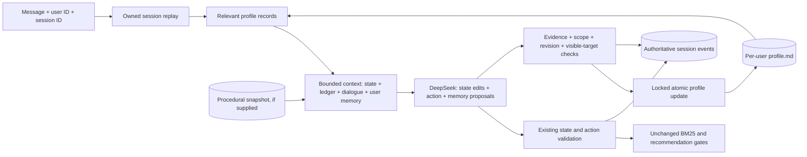

# Persistent user memory — Stage 1

Session history remains authoritative in `events.jsonl`; `state.json` remains its cache.
User memory is a separate, opt-in profile, not a second transcript or procedural lesson store.

`UserMemoryStore` stores `data/user-memory/<SHA256(user_id)>/profile.md`. A single readable
Markdown file has Facts, Preferences, Dislikes and Purchases sections with active memories
as readable sentences. A collapsed audit section retains compact JSON provenance/history in
the same file; no companion database is used. Historical bullet profiles remain readable
without rewriting them on inspection. See [current representations](memory-representations.md).
One file permits an atomic replacement for a complete update batch; four independent files
would need a multi-file transaction. Files are read/updated through the store, not arbitrary
model file operations. Manual edits outside the canonical format fail closed.

`MemoryProposal` supports ADD, REPLACE and RETRACT. Records include confirmed/inferred basis,
scope, exact current-user quote, source session/event, timestamps and lifecycle status.
Corrections preserve superseded records; withdrawals retain a source-event link. Current
profile revision and per-user thread/process locks protect simultaneous sessions. A durable
source-event check makes a committed batch idempotent. A profile has at most 500 historical
records and 512,000 bytes; it is not silently truncated.

Evidence checks are conservative English rules, not a semantic proof. A literal value and
scope must be supported by the quote, personal ownership must be expressed, and ordinary
preferences and facts require an explicit persistence/frequency cue. Gift/one-off turns fail closed. Purchase
records require an explicit user statement that they bought, purchased or ordered the item.
Recommendations never create purchases. Uncertain statements cannot be stored as confirmed.
Changed or outdated information is explicitly superseded/retracted; there is no automatic
expiry or LLM deletion. The source session supplies the complete audit conversation.

Profiles are private ignored data. Local owner IDs provide the same boundary as existing
sessions; this does not add hosted authentication or protection against another local process
with filesystem access. User IDs are hashed into directory names, never used as paths.

## Runtime and controls

`ShoppingAgent(..., user_memory=UserMemoryStore(root))` enables the layer; `None` is OFF.
The local UI exposes **Remember me across chats** (default OFF). Use the same shopper label
to retain the same `user_id`; **New chat** changes only the session UUID. The CLI uses:

```bash
.venv/bin/python -m shopping_agent chat --user alice --user-memory
# Optional location: --user-memory-root data/user-memory
```

UI storage defaults to `data/user-memory`; process setting `ASTRA_USER_MEMORY_ROOT` overrides
it. OFF disables reads AND writes and preserves existing profiles. It does not delete them.
All normal chat commands still call DeepSeek; this checkpoint used only mocked providers.

Each decision selects at most eight active records: matching scopes, then general records,
with explicitly mentioned values prioritized to make older memories correctable. Matching
uses literal words and a small plural normalization, not embeddings. The full profile is
inspectable even when not all records are in context. Confirmed/inferred basis stays visible.
Remembered preferences are advisory for questions, queries and ranking: they never silently
become hard requirements. Current session requirements and gift recipients take precedence.

Normal chat uses `shopping-baseline-v7-compact-memory` with attribute-based state and selected
ref/text memories. Structured memory proposals remain evidence-validated. Legacy evaluation
uses v6/MemoryDecision when user memory is enabled and v5/Decision when disabled. Both formats
use one response for state edits, memory proposals and an action; there is no extraction call.

Python independently validates each profile-update batch against the actual owned current
user event, the profile revision, and (for corrections) IDs visible in that decision. A batch
is all-or-nothing. Valid updates can persist even if the subsequent shopping action is rejected,
as with existing session edits. Shopping and profile files are not a cross-file transaction;
source-event idempotency prevents repeated profile writes if execution is interrupted after
the profile replacement. Completed request retries return their saved response. No background
job re-extracts history or overwrites the profile.

Rejected profile writes do not invalidate an otherwise valid shopping action. They appear in
`user_memory_update_rejected` events and the response's `user_memory.rejected` field; the UI
displays a warning. Corrupt/unavailable profile reads stop before a provider call rather than
silently supplying an empty profile. Session history remains the source of the actual quote.

Trace events distinguish `user_memory_selection`, exact `user_memory_injection`, accepted
`user_memory_updated` and rejected updates. These establish data flow and persistence, not
whether DeepSeek used a memory beneficially. There is no automatic memory-effect score yet.



## Two-session example (illustrative excerpts)

Before Session 1 there is no profile file. An empty read has revision 0.

Session 1, Alice: **I generally prefer blue bags.** The model proposes preference/color/blue,
scope=bags, with that exact quote. After validation the readable part of the file contains:

```markdown
# ASTRA user memory

User: alice

## Preferences
- Usually prefers color: blue (for bags).
```

Session 2 uses the same user ID and a new session ID. **I need a bag** receives this preference
without repeating it. **Actually I now generally prefer black bags instead of blue** can then
propose REPLACE using the current short memory reference (legacy mode uses the record ID).
The readable section becomes:

```markdown
## Preferences
- Usually prefers color: black (for bags).
```

The old blue record is superseded, and links to the new record/source event remain in the
collapsed audit metadata. These excerpts omit that required metadata and the empty sections;
they are not replacement profile files. New inference records are visibly labelled unconfirmed.
There is still no purchase record unless Alice explicitly confirms buying something.

## Existing evaluator and future seams

The current single-session evaluator is unchanged and constructs agents with user memory OFF,
even when procedural memory is ON. Existing frozen tasks/results are not migrated or rescored.
Stage 1 did not implement a longitudinal evaluator. Stage 2 now provides
[development timeline orchestration](longitudinal-evaluation.md) using these application
interfaces. The four-condition experiment CLI remains unimplemented.

Interfaces originally proposed in Stage 1 (see Stage 2 documentation for implemented timeline
types and orchestration; the external learner below remains documentation only):

- **Customer timeline input:** stable `user_id`, private persona/background, ordered frozen
  shopping goals, optional dated preference changes and per-goal scoring truth.
- **Longitudinal runner:** calls existing `agent.turn(user_id, session_id, message, ...)` with
  a fresh session for each goal and the same user ID; each condition has its own profile root.
  Shopper-private persona never seeds ASTRA's learned profile. Freeze the allowed history,
  ordering, warm-up and reset policy before comparisons.
- **Condition composition:** independent `user_memory` and `experience` arguments already
  exist on `ShoppingAgent`; future orchestration can select OFF/OFF, ON/OFF, OFF/ON, ON/ON.
- **External learner:** verified learning-split traces plus sanitized outcome feedback in;
  candidate `Lesson` records out through existing validation and `add_candidate()`. No direct
  activation, target identifiers, private user-profile ingestion or source-code edits. Current
  procedural extraction remains template-based; no external LLM learner is implemented.

## Verification and limits

`test_user_memory.py` covers persistence, ownership, evidence, scope, temporary/gift inputs,
negation, uncertainty, purchase confirmation, corrections, withdrawal, stale revisions,
idempotency, corrupted/symlinked files, atomic failure and limits. `test_user_memory_agent.py`
covers real executor contexts and compatibility. `test_user_memory_ui.py` exercises opt-in
cross-chat recall via mocked HTTP, the OFF switch and CLI defaults.

Conservative English parsing can reject valid paraphrases or mixed personal/gift statements.
It is not complete semantic validation. An explicit persistence cue is necessary but not
proof of everlasting truth. The operator must keep IDs stable; local labels are not accounts.
No live formation quality, shopping improvement, longitudinal behaviour or token-cost effect
has been measured in Stage 1.
